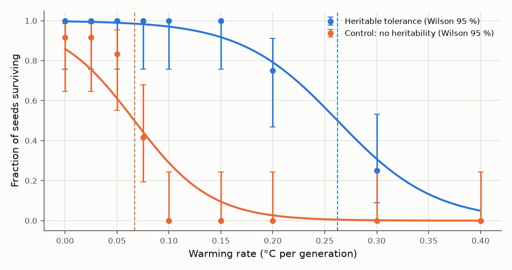
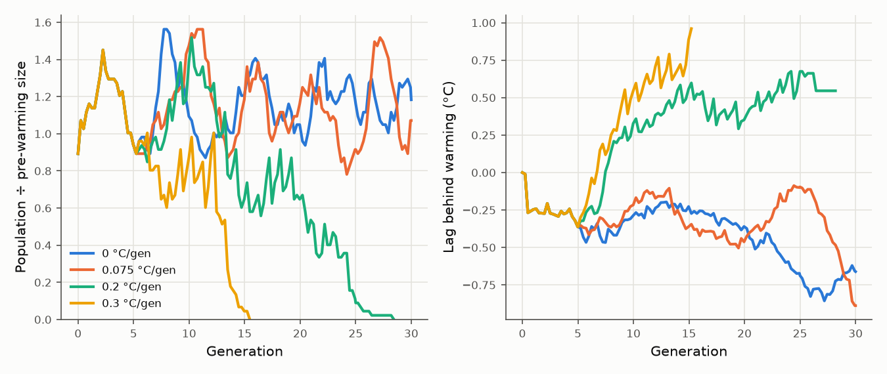
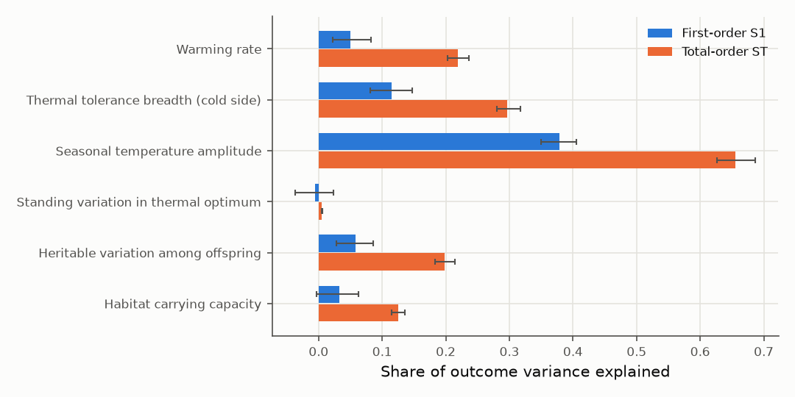

# Climate rescue: can evolution outrun warming?

> **Climate forcing is observed data; the organism is a generic model, not a calibrated
> real species.**

Vikasa's climate module asks one question: **can a population evolve fast enough to
survive a warming climate, and how fast is too fast?** This is *evolutionary rescue*
(Gomulkiewicz & Holt 1995; Bell & Gonzalez 2009). Quantitative-genetic theory (Lynch &
Lande 1993; Bürger & Lynch 1995) predicts a **critical rate of environmental change**.
Below it, adaptation keeps pace and the population settles at a constant lag behind its
moving optimum. Above it, the lag keeps growing until the population dies out.

The module measures that critical rate in an individual-based simulation. It then adds:

- a **real-data climate twin**: NASA POWER temperature for real Indian regions, plus
  IPCC AR6 warming pathways;
- a **global sensitivity analysis**: Sobol indices showing which factors decide survival;
- a **Gaussian-process surrogate**: instant predictions with uncertainty;
- an **offline HTML report**, plus JSON evidence and a SHA-256 manifest.

## Quick start

```powershell
# Everything, end to end (resumable: rerun the same command after any interruption)
.\.venv\Scripts\vikasa.exe climate pipeline --profile full --root exports\climate\full

# A few-minute smoke version of the same pipeline
.\.venv\Scripts\vikasa.exe climate pipeline --profile quick --root exports\climate\quick

# Your own region and organism (any latitude/longitude)
.\.venv\Scripts\vikasa.exe climate fetch --lat 18.52 --lon 73.86 --name "Pune" --key pune --output data\pune.json
.\.venv\Scripts\vikasa.exe climate assess --root exports\climate\full --region data\pune.json --generation-years 2 --breadth 3 --ssp SSP2-4.5 --ssp SSP5-8.5
.\.venv\Scripts\vikasa.exe climate report --root exports\climate\full
```

Open `exports\climate\full\report\index.html` in any browser. It needs no internet
connection. The committed evidence from the full run lives in
[`docs/results/climate-rescue-2026-10-18/`](results/climate-rescue-2026-10-18/index.html).

## Model description (ODD protocol)

### Purpose and patterns
The model estimates the warming rate, in °C per generation, beyond which a population
with heritable thermal tolerance can no longer persist. It also checks how much of that
persistence comes from evolution rather than from standing variation alone. Patterns the
model is expected to reproduce:
- survival falls as the warming rate rises;
- heritability raises the tolerable rate;
- the evolved shift tracks warming at slow rates;
- the adaptation lag grows with the rate (Lynch–Lande).

### Entities, state variables and scales
- **Animals** carry six heritable body genes (unchanged from Vikasa), temperament,
  energy, injury and age. They also carry a **thermal optimum θ (°C)** and their current
  **thermal stress s ∈ [0, 1)**.
- **Environment**: temperature T(t) in °C = monthly climatology(phase of year) +
  warming anomaly(year). Seasons follow the climate year.
- **Scales**: a two-dimensional 480 × 320 world with tens of animals. Time is in ticks.
  The generation interval G is *measured* (see Calibration), and results are reported
  per generation.

### Process overview and scheduling
Each tick runs the existing Vikasa schedule: environment update, perception and
decisions, movement and energy, fights, feeding, reproduction, deaths. Thermal stress is
computed in the energy step, before the basal cost. It affects reproduction eligibility
and the cause assigned to injury deaths in the same tick.

### Design concepts
- **Thermal performance** is an asymmetric Gaussian (Huey & Kingsolver 1989). With
  mismatch d = T − θ and width ω on the cold side, ω × 0.6 on the warm side, stress is
  s = 1 − exp(−d²/2ω²).
- **Costs of stress:**
  - basal energy cost × (1 + 1.5 s);
  - injury +0.02·(s − 0.3)/0.7 per tick when s > 0.3;
  - no breeding while s > 0.7 (heat-induced sterility; Walsh et al. 2019).
- **Inheritance** follows the infinitesimal model: child θ = parental mean +
  N(0, 0.4 °C) + N(0, 0.1 °C). The **control** arm gives offspring θ drawn fresh from the
  founder distribution: the same spread, but zero heritability.
- **Stochasticity**: every run is seeded and deterministic. Replicates differ only by
  seed.

### Initialisation
Founders' θ ~ N(local annual mean + starting anomaly, 1 °C). World, resources and
population come from `config/climate-rescue.json`.

### Input data
- **Observed temperature**: NASA POWER monthly 2 m air temperature (MERRA-2
  reanalysis), 1981–2025. Each region file holds the raw series, the 1991–2020 monthly
  climatology, an OLS trend ± SE, and provenance (URL, retrieval time, SHA-256 of the
  response). Bundled regions:

  | Region | Annual mean (°C) | Seasonal amplitude (°C) | Observed trend 1981–2025 (°C/decade) |
  |---|---|---|---|
  | Western Ghats (Agumbe) | 25.3 | 2.4 | +0.169 ± 0.029 |
  | Delhi NCR | 25.6 | 11.1 | −0.120 ± 0.068 |
  | Sundarbans | 26.2 | 5.4 | −0.002 ± 0.030 |

  The slight Delhi cooling in MERRA-2 is reported as measured. It is consistent with
  aerosol and haze dimming over the Indo-Gangetic plain, and is a property of this
  dataset, not a forecast.
- **Warming pathways**: IPCC AR6 WG1 Chapter 4 Table 4.5, global surface air
  temperature change for 2081–2100 relative to 1995–2014. Medians: SSP1-2.6 0.9 °C,
  SSP2-4.5 1.8 °C, SSP3-7.0 2.8 °C, SSP5-8.5 3.5 °C. The anomaly is linear from 2005 (the
  centre of the reference period) to 2090, times an optional regional factor (default 1).

### Submodels and calibration
- **Generation interval** = 1 / slope of mean living ancestry depth per tick, at zero
  warming, averaged over three seeds. Rescue world: **G = 469 ticks**.
- **Rescue protocol**: 5 generations of burn-in, then 20 generations of warming at
  rate r, then 5 generations of hold. For the sweep, one generation = one climate year,
  using the Western Ghats climatology and ω = 4 °C.
- **Outcomes per run**:
  - survival;
  - extinction generation;
  - population before warming, at its minimum and at the end;
  - evolved shift in mean θ;
  - adaptation lag (warming − shift) over the last 5 warming generations;
  - the rescue signature (dip below 50 %, then recovery to ≥ 80 %).

## Experiments and statistics

| Stage | Design | Statistics |
|---|---|---|
| Rate sweep | 9 rates (0 – 0.4 °C/gen) × {heritable, control} × 12 seeds | Wilson 95 % per cell; logistic fit; critical rate k<sub>c</sub> at p = 0.5 with 2,000-resample bootstrap CI; paired bootstrap for the rescue gain |
| Sensitivity | Two 192-run Latin hypercubes (384 runs) over 6 inputs + 48 held-out runs | GP surrogate (Matérn 5/2 + noise); 5-fold CV and hold-out R², AUC, Brier; Sobol S1/ST (Saltelli sampling, Jansen estimators, n = 4,096) |
| Regional assessment | 3 regions × 4 SSPs × 12 seeds for a reference organism (ω = 4 °C) and a locally adapted one (ω = 1.5 × seasonal amplitude), real monthly cycle, 2025 onward | Survival fraction, Wilson 95 %, verdict; surrogate and sweep references with domain checks |

Success criteria were fixed before the production run
(`docs/superpowers/plans/2026-10-18-climate-rescue.md`). Failures are reported as
failures.

## Results

All numbers come from `docs/results/climate-rescue-2026-10-18/` (full profile, 12 seeds
per cell, 2,000 bootstrap resamples).

### 1. Evolution roughly quadruples the warming a population can survive



| Arm | Critical rate k<sub>c</sub> (°C/generation) | 95 % CI |
|---|---|---|
| Heritable thermal tolerance | **0.262** | 0.234–0.291 |
| Control: same variation, no heritability | **0.067** | 0.052–0.080 |
| **Rescue gain** (paired bootstrap) | **+0.196** | 0.165–0.230 |

Heritable populations survived every seed up to 0.15 °C/generation, 9/12 at 0.2, 3/12
at 0.3 and none at 0.4. Controls began failing at 0.075 °C/generation and none survived
0.1.

### 2. Adaptation tracks warming with a growing lag, as theory predicts
- The evolved shift in mean optimum grows with the rate: +1.2 °C at 0.1, +2.9 °C at 0.2
  and +4.5 °C at 0.3 °C/generation, against 2, 4 and 6 °C of warming.
- The lag behind the moving optimum rises linearly with the rate. Slope 6.4 °C per
  (°C/generation), Pearson r = 0.85, n = 81 surviving runs. This is the Lynch–Lande
  prediction.
- Near the critical rate, 17–25 % of surviving runs show the classic rescue signature:
  the population dips below half its size and then recovers.



### 3. What matters most (Sobol, survival probability)
Total-order indices over the explored ranges:

| Input | ST |
|---|---|
| Seasonal amplitude | 0.66 |
| Tolerance breadth | 0.30 |
| Warming rate | 0.22 |
| Heritable variation (segregation SD) | 0.20 |
| Carrying capacity | 0.13 |
| Standing variation | ~0 |

Seasonal swings relative to tolerance breadth dominate. Over the range explored
(0.5–8 °C amplitude, 2–8 °C breadth), many combinations are lethal before any warming
starts. Indices depend on these ranges.



### 4. Real regions under IPCC scenarios
For an organism with a one-year generation time, warming of 0.011–0.041 °C/generation
(SSP1-2.6 to SSP5-8.5) is far below k<sub>c</sub>. Every viable population persisted:
p ≥ 0.92, n = 12, all four scenarios, 2025–2065.

| Region | Reference organism (breadth 4 °C) | Locally adapted organism (1.5 × seasonal amplitude) |
|---|---|---|
| Western Ghats (Agumbe) | persists under all SSPs (p = 0.92–1.0) | same as reference: 1.5 × 2.4 °C < 4 °C |
| Delhi NCR (±11.1 °C seasons) | **not viable even without warming** | breadth 16.6 °C: persists under all SSPs (p = 0.92–1.0) |
| Sundarbans (±5.4 °C) | **not viable even without warming** | breadth 8.2 °C: persists under all SSPs (p = 1.0) |

The risk sits with long-lived species. Dividing k<sub>c</sub> by each scenario's warming
rate gives the **critical generation time**: species with longer generations fall behind.

| Scenario | Global warming rate (°C/yr) | Critical generation time (years, 95 % CI) |
|---|---|---|
| SSP1-2.6 | 0.011 | 24.8 (22.1–27.5) |
| SSP2-4.5 | 0.021 | 12.4 (11.0–13.7) |
| SSP3-7.0 | 0.033 | 8.0 (7.1–8.8) |
| SSP5-8.5 | 0.041 | 6.4 (5.7–7.1) |

So in this model, under high emissions (SSP5-8.5), organisms whose generations last more
than about six years cannot evolve fast enough. Under SSP1-2.6, that threshold rises
to about 25 years. The thresholds belong to the reference organism and inherit its
caveats.

### 5. Success criteria (fixed before the run)

| ID | Criterion | Result |
|---|---|---|
| C1 | Populations persist without warming | **PASS**: 12/12 |
| C2 | Faster warming lowers survival | **PASS**: Spearman ρ = −0.84 |
| C3 | Heritability raises k<sub>c</sub> | **PASS**: gain CI 0.165–0.230 |
| C4 | Optima track ≥ 50 % of warming and ≥ 2× the control shift at ≤ k<sub>c</sub>/2 | **FAIL**: ≥ 50 % holds, but controls also shift by about half as much. Heat kills cold-adapted individuals within each generation, so the *surviving* control population's mean optimum moves even though nothing is inherited. |
| C5 | Lag grows with rate | **PASS**: r = 0.85 |
| C6 | No invariant violations or failed runs | **PASS**: 0 / 0 |
| S9 | Surrogate hold-out R² ≥ 0.7 and AUC ≥ 0.85 | **FAIL**: R² 0.51, AUC 0.93, after the planned one-time escalation from 192 to 384 design runs. A single run's outcome is partly chance: even a perfect predictor explains at most about 78 % of single-run variance in the sweep, and near-threshold design points are noisier still. |
| S10 | Warming rate in the top 2 drivers | **FAIL**: ranks 3rd (ST 0.22), behind seasonal amplitude and tolerance breadth over the explored ranges. |

Failed criteria are reported as findings. No parameters were changed after the
production run to make them pass.

## Limitations
- The organism is generic. Only the climate forcing is real data.
- No plasticity, behavioural thermoregulation, migration or food-web effects:
  temperature acts only through the tolerance curve.
- Populations are small (tens of animals), so demographic chance matters more than in
  most wild populations.
- Regional warming is the AR6 global-mean pathway times a regional factor, not a
  downscaled regional projection.
- The direct regional assessment caps warming at 40 generations, so for annual species
  it covers 2025–2065. The report says when this cap applies.
- Ticks have no calibrated real-time meaning. Results are per generation and translated
  using the generation time you supply.

## References
- Bell, G. & Gonzalez, A. (2009). Evolutionary rescue can prevent extinction following environmental change. *Ecology Letters* 12: 942–948.
- Bürger, R. & Lynch, M. (1995). Evolution and extinction in a changing environment: a quantitative-genetic analysis. *Evolution* 49: 151–163.
- Gomulkiewicz, R. & Holt, R. D. (1995). When does evolution by natural selection prevent extinction? *Evolution* 49: 201–207.
- Grimm, V. et al. (2006, 2020). The ODD protocol for describing individual-based and agent-based models. *Ecological Modelling* 198: 115–126; *JASSS* 23(2): 7.
- Huey, R. B. & Kingsolver, J. G. (1989). Evolution of thermal sensitivity of ectotherm performance. *Trends in Ecology & Evolution* 4: 131–135.
- IPCC (2021). *Climate Change 2021: The Physical Science Basis*, Working Group I, Chapter 4, Table 4.5.
- Jansen, M. J. W. (1999). Analysis of variance designs for model output. *Computer Physics Communications* 117: 35–43.
- Lynch, M. & Lande, R. (1993). Evolution and extinction in response to environmental change. In *Biotic Interactions and Global Change*, Sinauer.
- NASA POWER Project, Langley Research Center: monthly T2M from MERRA-2.
- Rasmussen, C. E. & Williams, C. K. I. (2006). *Gaussian Processes for Machine Learning*. MIT Press.
- Saltelli, A. et al. (2010). Variance based sensitivity analysis of model output. *Computer Physics Communications* 181: 259–270.
- Walsh, B. S. et al. (2019). The impact of climate change on fertility. *Trends in Ecology & Evolution* 34: 249–259.
