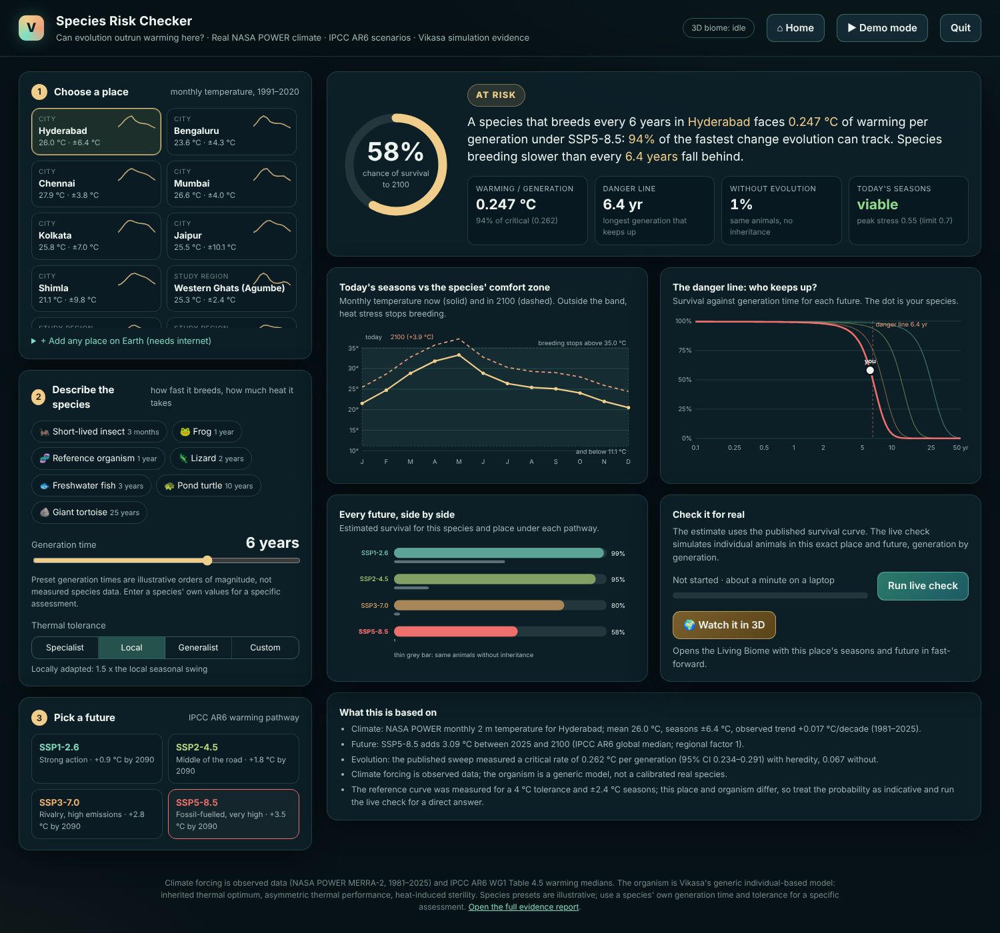

# Species Risk Checker

> **Will a species keep up with warming in a real place?** Pick a place, describe the
> species (how fast it breeds and how much heat it takes) and choose an IPCC future.
> Vikasa answers three ways: an instant estimate, a live individual-based simulation and
> a 3D replay.



```powershell
.\.venv\Scripts\vikasa.exe risk                       # opens the app in your browser
.\.venv\Scripts\vikasa.exe risk check --place hyderabad --generation-years 6 --ssp SSP5-8.5
.\.venv\Scripts\vikasa.exe risk check --place jaipur --tolerance specialist --live
.\.venv\Scripts\vikasa.exe risk places                # list the bundled places
```

The climate is real. The organism is Vikasa's generic model, whose generation time and
tolerance you choose. Species presets are illustrative orders of magnitude, not
measured species data.

## 1. Inputs

| Input | Meaning | Where it comes from |
|---|---|---|
| **Place** | Monthly 2 m air temperature, 1991–2020 climatology, plus the 1981–2025 trend | NASA POWER (MERRA-2) monthly T2M. Ten places are bundled; any latitude and longitude can be fetched live |
| **Generation time** | Years from birth to the average age of parents | You, or a preset (insect 3 months to giant tortoise 25 years) |
| **Thermal tolerance** | Width ω of the thermal-performance curve; the hot side is 0.6 ω | *Specialist* 1 × the local seasonal swing, *Local* 1.5 ×, *Generalist* 2.5 ×, or a custom °C value |
| **Future** | Warming pathway, 2025 to 2100 | IPCC AR6 WG1 Table 4.5 global medians, linear between 2005 and 2090 |

The tolerance modes follow the climatic-variability hypothesis: species that live with
bigger seasonal swings tolerate wider temperature ranges. The *Local* factor (1.5 ×)
is the same one the published pipeline uses for its "locally adapted organism".

### Bundled places

| Key | Place | Annual mean | Seasons (±) | Trend 1981–2025 |
|---|---|---|---|---|
| `hyderabad` | Hyderabad | 26.0 °C | 6.4 °C | +0.017 °C/decade |
| `bengaluru` | Bengaluru | 23.6 °C | 4.3 °C | +0.092 °C/decade |
| `chennai` | Chennai | 27.9 °C | 3.8 °C | +0.063 °C/decade |
| `mumbai` | Mumbai | 26.6 °C | 4.0 °C | +0.127 °C/decade |
| `kolkata` | Kolkata | 25.8 °C | 7.0 °C | −0.037 °C/decade |
| `jaipur` | Jaipur | 25.5 °C | 10.1 °C | −0.075 °C/decade |
| `shimla` | Shimla | 21.1 °C | 9.8 °C | −0.043 °C/decade |
| `western-ghats` | Western Ghats (Agumbe) | 25.3 °C | 2.4 °C | +0.169 °C/decade |
| `delhi-ncr` | Delhi NCR | 25.6 °C | 11.1 °C | −0.120 °C/decade |
| `sundarbans` | Sundarbans | 26.2 °C | 5.4 °C | −0.002 °C/decade |

Values describe the reanalysis grid cell (about 0.5°), not a weather station. Shimla's
cell includes lower terrain than the town, so it reads warmer than station records.
Small or negative trends over the Indo-Gangetic plain are a known property of MERRA-2
(aerosol dimming) and are reported as measured. The city files are rebuilt by
[`tools/build_city_regions.py`](../tools/build_city_regions.py); each stores the API
URL, the retrieval time and the SHA-256 of the response.

## 2. The instant estimate

### Step 1: can it live here today?

Founders start with a thermal optimum at the local annual mean. The screen applies the
model's own stress rule to the hottest and coldest months:

```
warm stress = 1 − exp(−(T_max − T_mean)² / (2 (0.6 ω)²))
cold stress = 1 − exp(−(T_mean − T_min)² / (2 ω²))
```

In the model, animals cannot breed while stress exceeds **0.7** (heat-induced
sterility). Peak stress above 0.75 is reported as *not viable*, 0.65–0.75 as
*borderline* (run the live check), and below 0.65 as *viable*.

This rule has no fitted parameters, yet it reproduces **all five baseline verdicts** in
the published regional assessment. A test enforces this
(`tests/climate/test_risk.py::test_seasonal_screen_reproduces_every_published_baseline_verdict`):

| Published assessment | ω | Peak stress | Screen | Published |
|---|---|---|---|---|
| Western Ghats, reference | 4.0 °C | 0.53 | viable | viable |
| Sundarbans, reference | 4.0 °C | 0.78 | not viable | not viable |
| Sundarbans, locally adapted | 8.2 °C | 0.30 | viable | viable |
| Delhi NCR, reference | 4.0 °C | 1.00 | not viable | not viable |
| Delhi NCR, locally adapted | 16.6 °C | 0.42 | viable | viable |

### Step 2: can evolution keep up?

Warming per generation is the SSP rate per year multiplied by the generation time. The
survival probability comes from the logistic curve fitted in the full climate-rescue
sweep (12 seeds at each of 9 rates, 2,000 bootstrap resamples), copied with provenance
into `src/evolution_sim/climate/data/risk-reference.json`:

| Quantity | Value |
|---|---|
| Critical rate with heredity | 0.262 °C per generation (95% CI 0.234–0.291) |
| Critical rate without heredity | 0.067 °C per generation (0.052–0.080) |
| Danger line (critical generation time) | critical rate ÷ warming per year: 24.8, 12.4, 8.0 and 6.4 years for SSP1-2.6 to SSP5-8.5 |

The app also shows the same animals *without* inheritance, so you can see how much of
survival is due to evolution.

**Domain check.** The curve was measured for ω = 4 °C and ±2.4 °C seasons (Western
Ghats). For any place or organism more than 25% away from those conditions, the app
labels the probability *indicative* and recommends the live check. Warming faster than
the fastest rate measured (0.4 °C per generation) is labelled *extrapolated*.

## 3. The live check

`Run live check` (or `vikasa risk check --live`) calls the same direct assessment as
`vikasa climate assess`:

1. It measures the organism's generation interval in today's climate (2 calibration
   seeds, 7,500 ticks each). If every calibration population dies with no warming at
   all, the verdict is *not viable in present-day climate*.
2. It runs 4 seeded populations: 5 generations of burn-in, up to 25 generations of
   warming along the chosen SSP from 2025, then 5 generations of hold.
3. It reports survivors out of n, a Wilson 95% interval and the verdict (≥ 80%
   *likely persists*, ≥ 20% *at risk*, otherwise *likely lost*).

Results are cached under `exports/risk/live/<place>-<hash>/`, together with
`assessment.json` and the raw `results.jsonl`. A six-year species in Hyderabad takes
about a minute on a laptop with 8 threads.

**When the two disagree, the live check is the answer.** For example, the estimate for
a six-year *locally adapted* species in Hyderabad under SSP5-8.5 is 58% (at risk),
because the reference organism has a narrow 4 °C tolerance. The direct simulation
gives that broader-tolerance organism 4 of 4 survivors. The app shows both side by
side and says which one to trust.

## 4. Watch it in 3D

`Watch it in 3D` writes `exports/risk/watch/<place>.json`, a Living Biome world with the
place's real monthly cycle, the organism's tolerance breadth, and the warming per
generation applied each climate year for 20 years after a 3-year settling period. It
then opens the Godot client. The top bar shows the live temperature; hover it to see
the adaptation lag.

## 5. Local API

`vikasa app`, `vikasa risk` and `vikasa demo` serve on `http://127.0.0.1:8787` (loopback only):

| Method | Path | Purpose |
|---|---|---|
| GET | `/` · `/risk` · `/demo` | Home screen · Risk Checker · presenter Demo hub |
| GET | `/api/meta` | Places, presets, tolerance modes, SSPs, reference curve |
| GET | `/api/estimate?place=&generation_years=&tolerance=&ssp=` | Instant estimate |
| POST | `/api/live` · GET `/api/live/<id>` | Start and poll a live check |
| POST | `/api/watch` | Write a scenario world and open it in 3D |
| POST | `/api/launch` | `biome`, `biome-demo` or `climate-demo` (whitelisted) |
| POST | `/api/fetch` | Download a new place from NASA POWER |
| GET | `/api/stats` · `/evidence/...` | Project statistics · the committed evidence report |

## 6. Limitations

- The organism is generic: no behavioural thermoregulation, plasticity, migration or
  food-web effects. Real species with shade-seeking behaviour will usually fare better
  than these verdicts suggest.
- Regional warming is the global-mean AR6 pathway multiplied by a regional factor
  (default 1), not a downscaled projection; local warming can differ.
- The instant estimate is anchored to one reference organism and its domain is
  flagged. The live check uses only 4 seeds for speed, so its Wilson intervals are wide.
- Reanalysis grid cells smooth over mountains and coasts.
