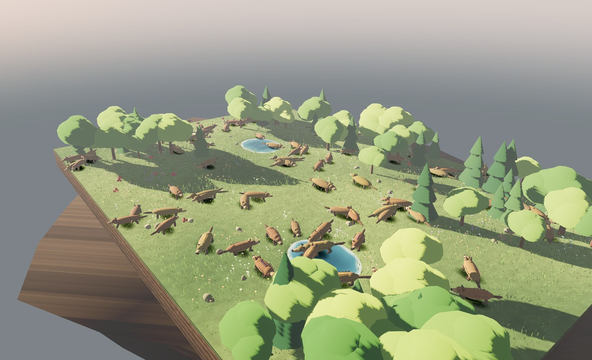
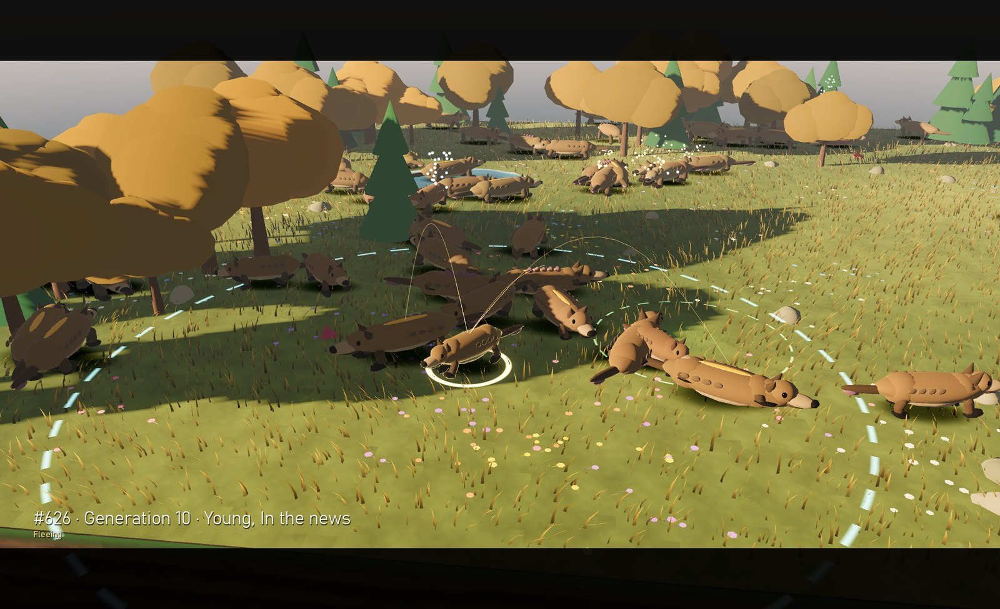
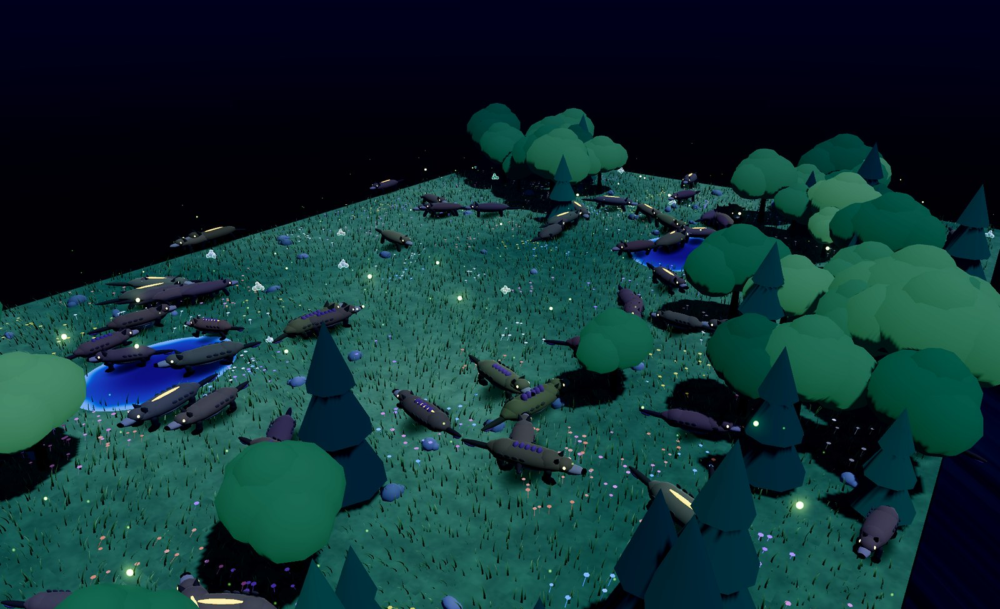
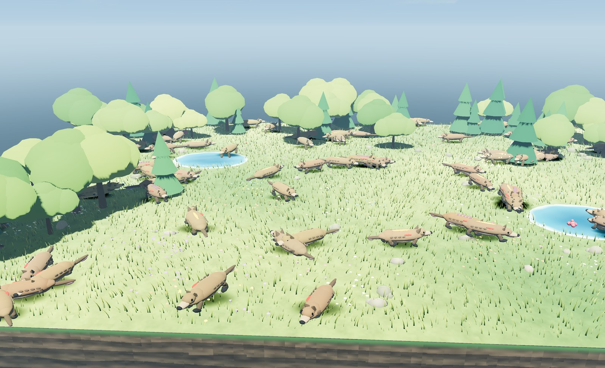
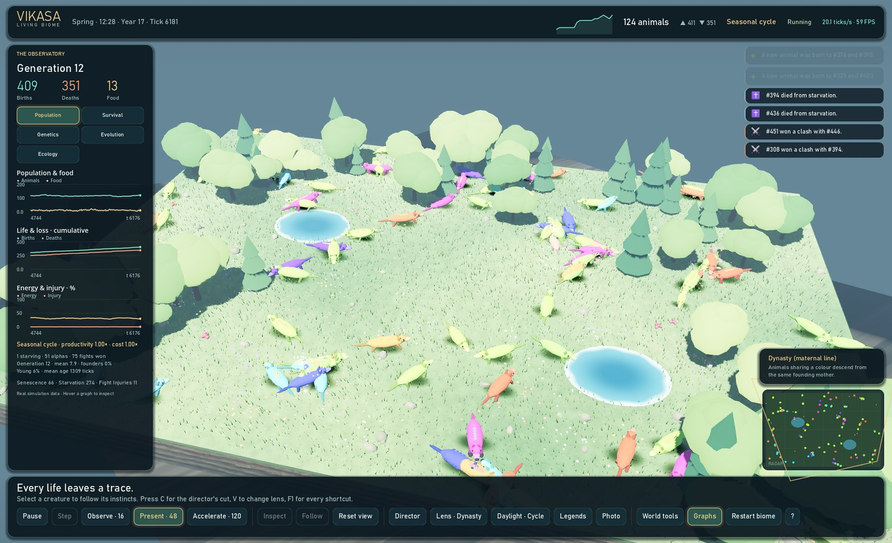
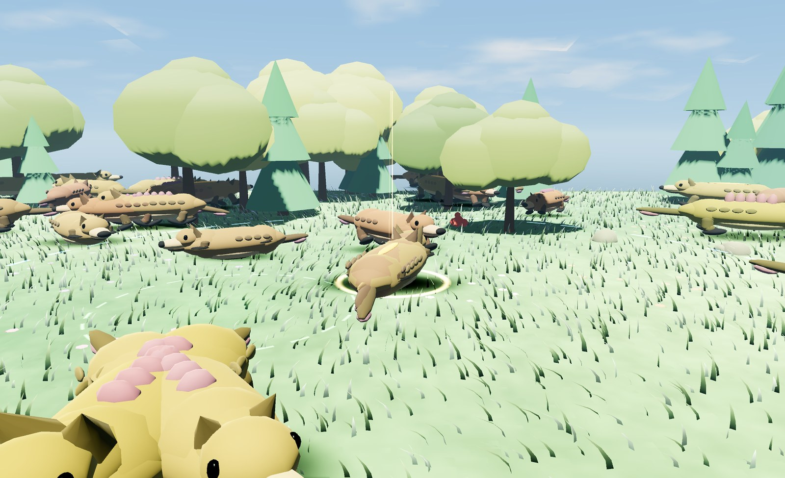
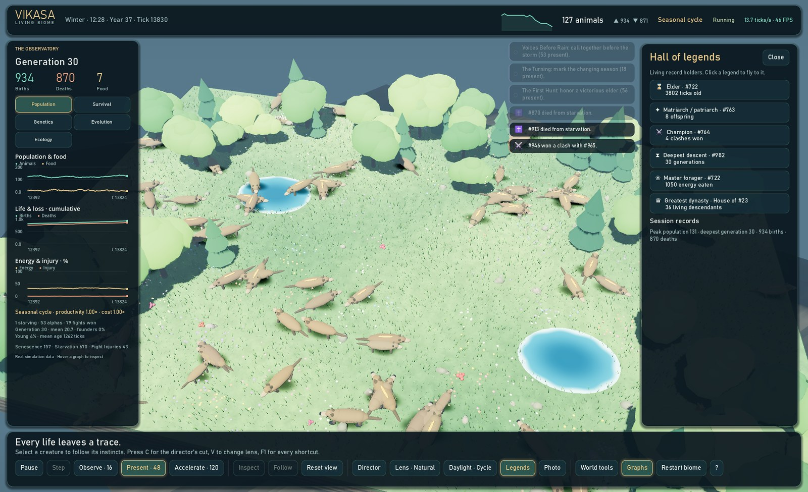
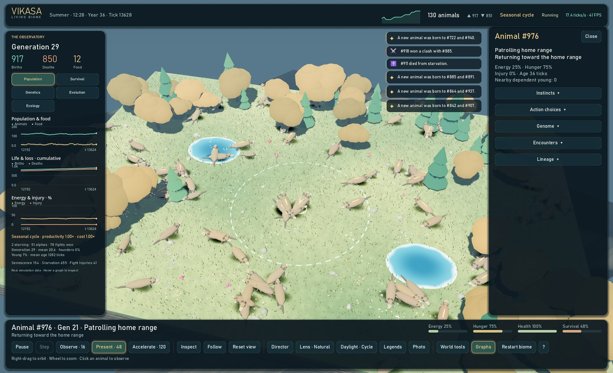
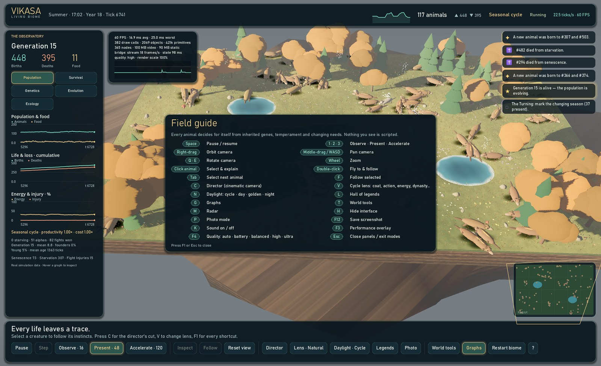

# Vikasa 2.0 — the Living Biome showcase

Vikasa 2.0 rebuilds the Godot client around one goal: a 3D artificial-life world
that looks alive and stays smooth on an ordinary laptop with integrated graphics.
The simulation is unchanged in its biology; everything here is presentation,
transport and interaction. Nothing on screen is scripted — every animal, birth,
death and clash comes from the deterministic Python engine.



## What you are looking at

| | |
| --- | --- |
|  |  |
| **Director's cut (C).** An autonomous camera hunts for stories — clashes, newborns, alphas, families — and frames them with letterbox and lower-third captions. It picks orbit angles that keep tree crowns out of the shot and only quotes an explanation when it matches the action on screen. | **Night (N).** A presentation daylight cycle with sun, moon, stars, a Milky band and drifting clouds. At night animal eyes return light (tapetum lucidum), fireflies drift over the meadow and food glows faintly. |
|  |  |
| **Weather you can see.** Rain streaks, wind-bent grass, rain rings on rippling pools and lightning with distance-delayed thunder; snow, embers, spores, pollen and dust for the other hazards. Pools swell in floods and shrink in drought. | **Lenses (V).** Recolour the same population by natural coat, current action, energy reserve, dynasty (maternal line), generation depth or temperament. The radar mirrors the active lens. |
|  |  |
| **Selection.** A live halo, the animal's sensing radius, its home range, a line to its current target and glowing threads to living parents and dependent young. Double-click flies to and follows an animal. | **Hall of legends (L).** The living elder, most prolific parent, champion, deepest descendant, best forager and largest dynasty — click any to fly there. |



The interface keeps the original explanatory tools (Observatory graphs, inspector
with instincts and action utilities, world tools) and adds a live event feed, a
radar minimap, a population sparkline, a field guide (F1) and a performance
overlay (F3).



## Controls

| Key / mouse | Action |
| --- | --- |
| Space · 1 · 2 · 3 | Pause/resume · Observe 16 · Present 48 · Accelerate 120 ticks/s |
| Right-drag · Middle-drag / WASD · Q/E · Wheel | Orbit · pan · rotate · zoom |
| Click · Double-click · Tab · F | Select & explain · fly to & follow · next animal · follow |
| C · V · N · L | Director · lens · daylight (cycle/day/golden/night) · legends |
| G · T · M · H · P | Graphs · world tools · radar · hide interface · photo mode |
| F12 · K · F3 · F4 · F1 · Esc | Screenshot to `Pictures/Vikasa` · sound · performance · quality · field guide · close |

In Director mode an extinct biome reseeds itself after a caption, so an unattended
showcase never stalls on an empty island.

## How it stays smooth

### Rendering

- **The whole population is two draw calls.** A procedural quadruped is baked once
  into a single mesh whose vertices are tagged with a body part and a material
  region. A vertex shader animates gait, lying down, head dips, idle glances, tail
  wags and gene-driven ears, ridges and tail length; the fragment shader shades
  hide, underside, eyes and the alpha mantle. Near and far LOD meshes are two
  `MultiMesh` draws; soft contact shadows are a third. Previously every animal was
  20–60 scene nodes and the frame cost ~2,300 draw calls.
- **Everything that repeats is instanced and animated on the GPU:** 26,000 wind-blown
  grass blades, wildflowers, broadleaf and conifer crowns, rocks, glowberry food,
  life-event particles (births, deaths, clashes, crowning, food blooms), weather and
  fireflies. Particle timing lives in float32 transform data because the
  Compatibility renderer stores MultiMesh custom data at half precision.
- **Light is cheap but cinematic:** a custom sky shader with no textures, ambient
  light from a colour (no radiance rebuilds), ACES tone mapping, glow, fog, one
  moving shadowed sun/moon with a 2048 orthogonal shadow map, and shadow casting
  limited to trees.

### Transport

| Channel | Format | Rate | Purpose |
| --- | --- | --- | --- |
| `GET /stream` | Length-prefixed little-endian float32 frames on one socket | up to 30 Hz | Positions, velocities, actions, genes, flags, lineage, food, season, weather |
| `GET /state?lite=1&focus=ID&hs=T&bs=T` | JSON, serialised once per publication | 2.5 Hz | Explanations for every animal (compact) plus full detail for the watched one, and only history rows newer than the client's cursors |
| `GET /frame` | Same frame as one response | on demand | Fallback when a stream cannot be opened |
| `POST /command` | JSON | on demand | pause, resume, speed, step, weather, food, `food_burst`, restart |

The client polls the stream socket without blocking once per rendered frame and
renders only the newest complete frame; motion is interpolated over the measured
frame interval. The explanatory document is parsed on a worker thread and applied
one consumer per rendered frame. The bridge's sequenced event feed means births,
deaths, clashes and traditions between polls are never lost.

### Adaptive quality

| Tier | Render scale | MSAA | Glow | Shadows | Grass | LOD distance |
| --- | --- | --- | --- | --- | --- | --- |
| battery | 72% | off | off | off | 35% | 26 |
| balanced | 85% | off | on | on | 60% | 36 |
| high | 100% | 2× | on | on | 85% | 48 |
| ultra | 100% | 4× | on | on | 100% | 72 |

`auto` (default) starts at *high*, steps down after two consecutive windows with
10% of frames slower than 23.5 ms, and climbs back after 20 seconds of headroom.
F4 cycles auto/battery/balanced/high/ultra; the choice persists. FXAA is always on.

**Battery power.** Plugged in, adaptive vsync gives a steady cadence at the display
refresh. On battery we measured vsync'd rendering near 45 FPS (and only ~33 FPS with
Godot's sleeping frame limiter) even though the same scene rendered at 110+ FPS
unlocked — consistent with Windows down-clocking the CPU and integrated GPU while a
frame waits, though OS power management makes this host-dependent. The bridge
therefore reports the host power source; in `auto`, if the lowest tier still misses
frames on battery the client switches to unlocked pacing, and it restores vsync when
mains power returns. A one-time feed message suggests plugging in. Measured on
battery after this change: auto settled on *balanced · unlocked* at 94.5 FPS (p99
29 ms). For a showcase, plug the laptop in.

## Measured on this machine

Intel Core i5-1335U with Iris Xe graphics, 1920×1200 at 59 Hz, Windows 11, Godot
4.7.2 Compatibility renderer, `config/showcase.json`, seed 2026, ~110–170 animals.
Numbers vary with power source and background load; runs were on battery unless noted.

| | Before (v1.1) | After (v2.0) |
| --- | --- | --- |
| Frame rate with vsync | 13–14 FPS (project cap 30 interacting with vsync) | **59.6–59.9 FPS** at *high* |
| Uncapped, full interface | 35–152 FPS, p99 36–157 ms | ~98–105 FPS *high*; **149 FPS** *balanced* |
| Frames over 25 ms (vsync) | — | **0.1–0.4%** (p99 21–22 ms, plugged in) |
| Draw calls / scene nodes | ~1,700–2,450 / ~3,000–3,600 | ~20 for the 3D world (~300 with interface) / 365 |
| Explanatory document | ~180–680 KB every 0.16–0.45 s | ~35 KB every 0.4 s |
| State request latency (server) | 49 ms median | 12 ms median |

Reproduce with a bridge on port 8766:

```powershell
.\.venv\Scripts\vikasa.exe serve --config config\showcase.json --seed 2026 --port 8766
& $env:VIKASA_GODOT_BINARY --path godot --script res://tests/PerfProbe.gd -- --port 8766 --seconds 15 --tier 2
& $env:VIKASA_GODOT_BINARY --path godot --script res://tests/PerfProbe.gd -- --port 8766 --seconds 15 --tier 1 --uncapped
```

`PerfProbe` prints mean and p99 frame time, the share of slow frames, draw calls,
node count and the active quality tier; `--breakdown` times each state consumer
and `--freeze`, `--no-state`, `--no-frames` isolate the streams. The probe never
overwrites saved quality choices.

Regenerate the gallery (1600 px JPEGs written to `docs/images/`):

```powershell
& $env:VIKASA_GODOT_BINARY --path godot --script res://tests/ShowcaseCapture.gd -- --port 8766 --docs --name showcase-hero --daylight golden --hide-ui --distance 60 --pitch 0.42 --yaw 0.9
& $env:VIKASA_GODOT_BINARY --path godot --script res://tests/ShowcaseCapture.gd -- --port 8766 --docs --name showcase-director --director 12 --daylight golden --settle 0.5
```

Other options: `--select`, `--follow`, `--view dynasty`, `--weather storm --duration 70`,
`--legends`, `--help`, `--perf`, `--focus x,z`. Captures send real commands to
the bridge: a long severe storm can drive the population extinct, exactly as the
model allows.

## Honest limits

- Daylight is a presentation clock; the model has seasons but no diurnal cycle.
  Seasons in the model last 96 ticks, so at Present speed a year passes in about
  eight seconds; the visual season blend is deliberately gentle.
- Sound is synthesised at startup (wind, rain, birds, crickets, thunder, chimes);
  it reflects weather and events but carries no extra information.
- The engine is two-dimensional. Terrain height, trees, water and weather particles
  are scenery and do not affect movement, perception or survival.
- Very large populations still render (the swarm holds 640 instances), but the
  Python engine, not the GPU, is then the limit.
